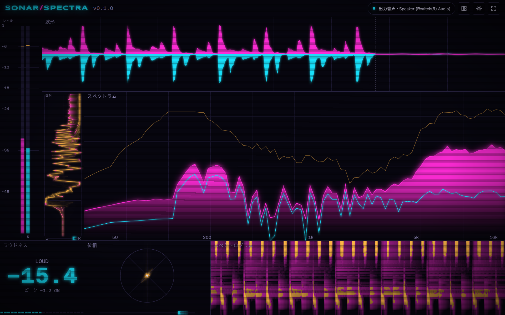

# Sonar Spectra

パソコンで鳴っている音を解析して、波形・スペクトラム・位相などをネオン調のメーターとして映す、WindowsとmacOS（Apple Silicon）向けのデスクトップアプリです。VJパフォーマンス中に、作業環境のモニターへ映す「見せるためのオーディオメーター」として作りました。

## 特徴

- **再生中の音をそのまま映せる**：起動するとすぐ、パソコンの出力デバイスで鳴っている音を取得して表示します。マイクや配線の準備は要りません
- **音を多面的に見せる**：レベル、波形、スペクトラム、位相、スペクトログラム、ラウドネス、VU、クロマ、重心と変化量を置けます。波形の「今の瞬間」や、スペクトラムの線・バー・鏡写し・円形など、見せ方を選べます
- **レイアウトを自由に組める**：画面の比に合わせた自動整列と、12×8の格子に沿った手動配置を切り替えられます。同じモジュールを複数置いて、配色・流れる速さ・流れる方向をそれぞれ変えられます
- **VJの現場で使いやすい**：ボーダレスフルスクリーン、常に最前面、フレームレートの上限（60・45・30 fps）に対応します。VJツールと同時に動かせるよう、負荷を抑えています
- **設定をまとめて保存できる**：配置・モジュールの設定・自分で作った配色を「構成」として名前を付けて保存し、ファイルに書き出して別のパソコンで読み込めます。前回の設定とウィンドウの位置は、次の起動に引き継がれます

## 入手方法

[GitHub Releases](https://github.com/rinfromniigata/sonar_spectra/releases)から、最新のリリースのファイルをダウンロードしてください。

- **Windows**：インストーラー（名前が`_x64-setup.exe`で終わるファイル）を実行します。0.1.0（表示名`sonar_spectra`）を入れているときは、そのまま新しい版のインストーラーを実行してください。0.1.0は自動で取り除かれ、設定と構成は引き継がれます
- **macOS**：ディスクイメージ（名前が`_aarch64.dmg`で終わるファイル）を開き、Sonar Spectraを「アプリケーション」フォルダーにドラッグします。初回の開き方と録音の許可は、下の「注意事項」を参照してください

## 動作環境

- Windows 10／11（64ビット）
- macOS 26以降（Apple Silicon）。Intel Macには対応しません

## 使い方

1. 音楽や動画など、パソコンで何かを再生してから、Sonar Spectra を起動します。再生中の音に合わせて、メーターが動きます
2. 画面の右上のボタンで、次の操作ができます（左から）
    - 出力系統：いま拾っている出力デバイスの状態を表します
    - レイアウト編集：モジュールの移動・大きさの変更・追加・削除をします。モジュールの見出しの歯車ボタンで、そのモジュールの配色などを変えられます
    - 設定：テーマ（ダーク・ライト・OS設定）、入力源の出力デバイス、配色の管理、構成の保存と切り替え、走査線、常に最前面、起動時にボーダレスフルスクリーン、フレームレートの上限を扱えます
    - ボーダレスフルスクリーン：枠のない全画面に切り替えます。全画面のあいだは、同じボタンで元に戻せます
3. 音が止まると、「音を待っています」と表示します。再生を始めると、自動で表示に戻ります

## 注意事項

- **初回起動時の警告（Windows）**：このアプリにはコード署名がないため、インストーラーを実行するときに、WindowsのSmartScreenが「WindowsによってPCが保護されました」と警告することがあります。「詳細情報」を押し、「実行」を選ぶと、インストールを続けられます
- **初回の開き方（macOS）**：このアプリはアドホック署名だけで、Appleの公証を受けていません。ダウンロードして最初に開くと、「開けません」という確認が出ます。いったん閉じ、「システム設定」→「プライバシーとセキュリティ」を開いて、下のほうにある「このまま開く」を押してください。版ごとに必要です
- **システムオーディオ録音の許可（macOS）**：初回の起動で、システムの音声を録音してよいか確認が出ます。許可してください。拒否した場合と、新しい版に更新した場合（アドホック署名では、更新のたびに別のアプリとして扱われるため）は、「システム設定」→「プライバシーとセキュリティ」→「画面とシステムオーディオ録音」で、Sonar Spectraをオンにしてください。操作しなくても、表示が始まります。許可がないあいだは、無音のように見えます
- **重いとき**：高解像度の外部ディスプレイなどで動きが重いときは、設定の「描画の解像度」を「等倍」に、フレームレートの上限を30 fpsにしてください。VJツールと同時に動かすときも、同じ設定が効きます
- **データの扱い**：設定と構成は、Windowsでは`%APPDATA%\com.rinontech.sonar-spectra`、macOSでは`~/Library/Application Support/com.rinontech.sonar-spectra`に、JSONで保存します。ネットワーク通信はせず、音声を保存したり送信したりもしません。書き出した構成ファイルは、選んだ場所に保存されます
- **既知の制限**：ラウドネス（LOUD）とクロマの値は近似で、規格に沿った測定や、正確な和声の分析ではありません。見た目の成立を優先しています
- **出力デバイスが見つからないとき**：再生デバイスが取り外されたか、ほかのアプリが占有していると、「出力デバイスが見つかりません」と表示します。デバイスをつなぎ直して、「再試行」を押してください
- 表示の言語は日本語だけです。入力デバイス（マイクなど）からの取得には、対応していません

## 更新履歴・ライセンス・開発

- 更新履歴：[CHANGELOG.md](CHANGELOG.md)
- ライセンス：[Apache License 2.0](LICENSE)
- 開発に参加するには：[CONTRIBUTING.md](CONTRIBUTING.md)
